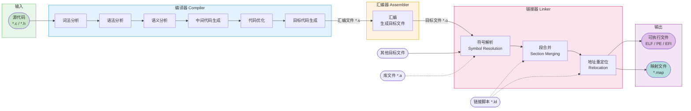

# 1.C语言的常见概念

# 1.1 C语言是什么？

​	人和人交流使用的是**自然语言**，如：汉语、英语、日语。

​	人和计算机是怎么交流的呢？使用**计算机语言**。

​	目前已知有上千种计算机语言，人们是通过计算机语言写的程序，给计算机下达指令，让计算机工作的。

​	C语言就是众多计算机语言的一种，当然C++/Java/Go/Python都是计算机语言。

## 1.2 C语言的历史和辉煌

​	C语言的雏形可以追溯到1969年，那是美国贝尔实验室的计算机科学家Dennis Ritchie**为了开发Unix操作系统而创造的**一种全新程序设计语言。最初，这个语言被称为“BCPL（Basic Combined Programming Language）”，但很快就被重写成了C语言，成为了Unix系统的主要编程语言之一。

​	随着时间的推移，C语言经历了多次演进，不断改进和完善。1978年，K&R C（Kernighan和Ritchie的C）版本出现，定义了许多现代C语言的特性。1989年，美国国家标准协会（ANSI）发布了C语言的标准，即ANSI C。1990年，国际标准化组织（ISO）发布了ISO C，这标志着C语言成为了一个国际标准。

​	C语言的辉煌时刻始于20世纪80年代和90年代，在这个时期，它成为了许多重要软件和系统的首选编程语言。Unix操作系统及其衍生系统（例如Linux）的内核大部分都是用C语言编写的。另外，许多广受欢迎的软件，如**MySQL数据库**、A**pache HTTP服务器**等，也是用C语言开发的。

​	C语言对计算机编程领域产生了深远的影响。首先，它的设计简洁、灵活，使得程序员可以用更少的代码实现复杂的功能，提高了编程效率。其次，C语言的可移植性极高，能够在不同的平台上编写和运行相同的代码，这使得软件开发变得更加灵活和便捷。此外，C语言的底层特性使得程序员能够直接操作计算机硬件，为系统编程提供了强大的支持。

​	尽管C语言已经存在了几十年，但它仍然是计算机编程界最重要的语言之一。随着计算机技术的不断进步，C语言也在不断发展和完善。例如，C99和C11标准引入了许多新特性和改进，使得C语言在现代软件开发中仍然保持着活力。

## 1.3 编译器的选择

### 1.3.1 编译和链接

​	**C语言**是一门**编译型**计算机语言，C语言源代码都是文本文件，文本文件本身无法执行，必须通过**编译器**翻译和**链接器**的链接，生成**二进制的可执行文件**，可执行文件才能执行。

C语言代码是放在`.c`为后缀的文件中的，要得到最终运行的可执行程序，中间要经过**编译**和**链接**2个过程。

### 1.3.2 编译器的对比

​	C语言是一门**编译型**的计算机语言，需要依赖编译器将计算机语言转换成机器能够执行的机器指令。常见的编译器有：**msvc**、**clang**、**gcc**，当然也有一些**集成开发环境**，如：VS2022、XCode、CodeBlocks、DevC++、Clion等。

> 集成开发环境(IDE)用于提供程序开发环竞的应用程序，一般包括代码编辑器、编译器、调试器和图形用户界面等工具。集成了代码编写功能、分析功能、编译功能、调试功能等一体化的开发软件服务套。

- VS2022集成了MSVC(安装包较大一些，安装简单，无需多余配置，使用起来非常方便)
- XCode集成了clang(苹果电脑上的开发工具)
- CodeBlocks集成了gcc(这个工具比较小众，需要配置环境，不太推荐)
- DevC++集成了gcc(小巧，但是工具过于简单，对于代码风格的养成不好，一些竞赛使用)
- Clion是默认使用CMake，编译器是可以配置的(工具是收费，所以暂时不推荐大家使用)

## 1.4 创建项目

