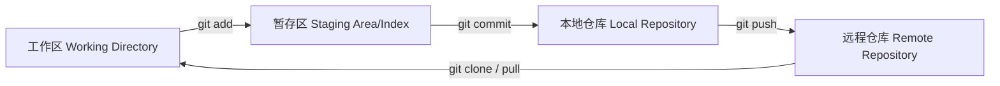

Git使用教程

# Git简介：

## 什么是Git

**Git** 是目前世界上最先进的**分布式版本控制系统**，由 Linux 之父 Linus Torvalds 于 2005 年创建，最初是为了管理 Linux 内核源码而设计。

> **版本控制**是一种记录文件内容变化（如代码、文档等）的系统，以便将来可以查阅特定版本的历史记录。

简单来说，Git 就像一个“**时光机 + 协作平台**”——它能记录你对文件的每一次修改，让你随时可以回到过去的任意版本，同时支持多人并行开发而不互相干扰。

### Git 的核心特性

- **分布式**：每个开发者的本地都拥有完整的仓库副本，包括完整的历史记录。
- **快照式**：Git 记录的是文件状态的快照，而非差异（diff），这使得切换版本极快。
- **数据完整性**：所有内容都通过 SHA-1 哈希值校验，确保数据不会被篡改。

## 为什么要用Git

无论是个人项目还是团队协作，Git 都能带来巨大的效率提升：

| 场景         | 没有 Git 的痛点                                                         | 使用 Git 的收益                                               |
|:------------:|:----------------------------------------------------------------------- |:------------------------------------------------------------- |
| **历史追溯** | 文件名从 `项目_final_v3_真最终版.zip` 到 `..._打死不改版.zip`，混乱不堪 | 每次提交都有清晰的日志，可随时查看、对比或回滚到任意版本      |
| **团队协作** | 代码通过 QQ/邮件互相传，覆盖对方代码是家常便饭                          | 多人可并行开发，Git 自动合并或提示冲突，冲突解决后无缝集成    |
| **分支管理** | 新功能开发不敢动主代码，只能复制整个项目另起炉灶                        | 轻松创建/合并分支，支持功能开发、Bug 修复、实验性尝试并行进行 |
| **代码备份** | 依赖网盘手动上传，容易遗忘                                              | 一键推送到远程仓库（GitHub/GitLab 等），云端自动备份          |
| **责任追溯** | 出 bug 了不知道谁改的、什么时候改的                                     | `git blame` 可以精确定位每一行代码的作者和提交时间            |

## Git vs SVN的简单对比

SVN（Subversion）是 Git 出现前最主流的集中式版本控制系统。两者核心对比如下：

| 对比维度     | **Git（分布式）**                              | **SVN（集中式）**                          |
|:------------:|:---------------------------------------------- |:------------------------------------------ |
| **仓库结构** | 每个本地都有完整仓库                           | 只有中央服务器有完整仓库，本地只有工作副本 |
| **网络依赖** | 大部分操作（提交、查看历史、分支切换）离线可用 | 几乎所有操作都需要连接中央服务器           |
| **分支成本** | 分支创建/合并极轻量（秒级），鼓励频繁建分支    | 分支本质是目录拷贝，成本高，操作笨重       |
| **提交粒度** | 先提交到本地，择机推送到远程                   | 每次提交必须立即上传到中央服务器           |
| **存储方式** | 基于内容寻址的快照存储                         | 基于文件差异（增量）存储                   |
| **学习曲线** | 较陡，概念较多（暂存区、Rebase 等）            | 相对平缓，上手简单                         |

SVN 适合小团队、单一主干线项目；Git 适合大规模协作、复杂分支管理的现代开发流程。如今 Git 已成为业界绝对主流。

## Git的工作流程概览

- **工作区（Working Directory）**：你本地修改文件的实际目录，是当前检出的某个版本的内容。
- **暂存区（Staging Area / Index）**：一个临时存放修改列表的区域。`git add` 将工作区的改动选中并放入此处，让你可以精细控制每次提交的内容组合。
- **本地仓库（Local Repository）**：`git commit` 将暂存区的所有改动以一次原子性快照永久保存到本地的 `.git` 目录中。**注意：此时还未影响他人。**
- **远程仓库（Remote Repository）**：托管在服务器（如GitHub/GitLab/Gitee）上的共享仓库。`git push` 将本地提交同步至远程，`git pull`（实质是 `fetch + merge`）则将远程新变更拉取到本地并合并。



# 安装与配置

## 安装

详情见官网[Git - 安装 ](https://git-scm.com/book/zh/v2/起步-安装-Git)，包含了Windows/Linux/Mac OS

## 配置

首次配置：

```bash
git config --global user.name "你的名字"
git config --global user.email "你的邮箱"
```

查看配置：

```bash
git config --list
```

# 基础操作

创建一个新仓库：

```bash
git init
```

克隆仓库：

```bash
git clone https/ssh "项目地址"
```

只克隆一个分支：

```bash
git clone --single-branch -b "branch的名字" "项目地址"
```

还原至上一次推送：

```bash
git reset --hard HEAD
```

回溯至某一个版本：

```bash
# 查看历史日志记录
git log

git reset --hard "版本编号"
```

推送代码：

```bash
# 查看文件状态
git status

# 添加要推送的文件，可按Tab预览要选择的文件
git add （按下Tab）
git add history/ FlashUtil/ xxxxx.md # 如果文件一次没加全再git add 需要加的文件即可

# 也可以使用如下代码将修改的文件全部添加，按需要选择
git add .

# 如果加入要推送的文件有要移除的
# 撤回单个文件
git restore --staged path/to/file

# 撤回整个目录
git restore --staged path/to/dir/

# 撤回全部已 add 的文件
git restore --staged .

# 确认结果
git status           # 撤回的文件会回到 "Changes not staged for commit"
git diff --cached    # 查看当前还留在暂存区的内容（撤回后应为空）

# 推送上传代码
git push
```
